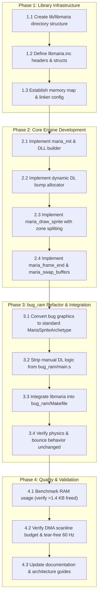

# `libmaria`: Dynamic Display List & Multi-Zone Sprite Engine

> **Design Specification & Implementation Plan**  
> **Status:** Draft / Planned  
> **Target Platform:** Atari 7800 ProSystem (MARIA II / 6502)  
> **Driving Reference Sample:** [`examples/bug_ram/`](../examples/bug_ram/)  
> **Related Architecture Document:** [`MariaArchitecture.md`](MariaArchitecture.md)
>
> **Author's Note / Living Document**: Everything documented here was discovered through reading vintage hardware manuals, inspecting community research, and actively building and testing working code samples on emulators and assembler toolchains with AI assistance. I might not have every nuance 100% right yet, but this is an evolving, living document that will continue to be refined and updated as I learn more through hands-on development.

---

## 1. Executive Summary & Objective

The Atari 7800 lacks hardware sprites and hardware scrolling. All on-screen elements—characters, moving enemies, HUD, backgrounds—must be scheduled into scanline **Display Lists (DL)** organized into a **Display List List (DLL)** of 8- or 16-scanline zones.

The initial [`examples/bug_ram`](../examples/bug_ram/) port successfully recreated the Atari ST "Silly Bugs" demo with 16 moving, bouncing sprites. However, its rendering pipeline currently uses **rigid, statically partitioned RAM buffers** (64 bytes per zone $\times$ 16 zones $\times$ 2 buffers = **2,048 bytes of RAM**, half the console's entire 4 KB RAM space) and tightly couples 6502 physics with manual MARIA Display List generation.

### Core Objective
Extract the dynamic display list rendering engine from `examples/bug_ram` into a standalone, reusable 6502 assembly library (**`libmaria`**). The library will provide:
1. **Dynamic Single-Pool Display List Allocation** that reduces RAM usage from 2,048 bytes to $< 600$ bytes.
2. **Automated Zone Boundary Splitting** so game code simply specifies $(X, Y)$ and an archetype pointer, with no manual slicing or zone calculation.
3. **Double-Buffered DLL Management** with tear-free VBLANK frame swapping.
4. **Zero-Overhead Static List Support** allowing static HUD/borders to reside 100% in ROM with 0 bytes of RAM overhead.

---

## 2. Architecture & Design Principles

```
┌───────────────────────────────────────────────────────────────┐
│               STAGE 1: Game Logic & Simulation                │
│  - 8.8 Fixed-point physics, collision detection, game state   │
│  - Zero knowledge of MARIA zones, DLL, or DL headers          │
│  - Calls: maria_draw_sprite(x, y, archetype_ptr)              │
└───────────────────────────────┬───────────────────────────────┘
                                │
                                ▼
┌───────────────────────────────────────────────────────────────┐
│                STAGE 2: `libmaria` Render Core                 │
│  - Dynamic DL Bump Allocator (writes directly to RAM pool)    │
│  - Automated Zone Slicing (Zone Z and Zone Z+1)               │
│  - Emits 4-byte Direct Headers & updates zone write offsets   │
│  - Writes $00, $00 terminators per active zone                │
└───────────────────────────────┬───────────────────────────────┘
                                │
                                ▼
┌───────────────────────────────────────────────────────────────┐
│              STAGE 3: VBLANK Hardware Flip                    │
│  - maria_swap_buffers waits for MSTAT VBLANK                  │
│  - Points DPPL/DPPH to newly assembled DLL / DL frame         │
│  - Switches active buffer index for next frame                │
└───────────────────────────────────────────────────────────────┘
```

### 2.1 The Dynamic Bump Allocator (RAM Savings)

Instead of partitioning RAM into 16 fixed-size zone buckets, `libmaria` manages a single continuous dynamic pool per frame buffer:

| Allocation Model | Zone RAM Usage | Empty Zone Cost | 16-Zone Overhead (2 Buffers) |
|---|---|---|---|
| **Static Fixed Buffers** (current `bug_ram`) | 64 bytes fixed / zone | 64 bytes | **2,048 bytes** |
| **`libmaria` Dynamic Pool** | Variable (4 B / sprite) | 2 bytes (`$00, $00`) | **$\approx 384 - 512$ bytes** |

#### RAM Layout:
```
$1800 - $18FF:  Zero Page / High-speed Game State & maria zero-page params
$1900 - $1AFF:  Display List Dynamic Pool Buffer A (512 bytes)
$1B00 - $1CFF:  Display List Dynamic Pool Buffer B (512 bytes)
$1D00 - $1D7F:  DLL Buffer A (16 zones * 3 bytes + terminator = 50 bytes)
$1D80 - $1DFF:  DLL Buffer B (16 zones * 3 bytes + terminator = 50 bytes)
$1E00 - $27FF:  Free RAM for Game State, Audio, Level Buffers (~2.5 KB free)
```

### 2.2 Zone Pointer Table Mechanism

During frame construction, each active zone maintains a 16-bit write pointer pointing into the shared pool:
1. `zone_dl_start[z]`: Start address of the display list for zone $z$. Written into DLL at `maria_frame_end`.
2. `zone_dl_ptr[z]`: Current write cursor for zone $z$.
3. When adding a sprite to zone $z$:
   - If zone $z$ has not yet received a sprite this frame, its `zone_dl_start[z]` is assigned to `dl_pool_curr_ptr`.
   - The 4-byte DL header is written to `dl_pool_curr_ptr`.
   - `dl_pool_curr_ptr += 4`.

> [!TIP]
> For maximum 6502 speed with up to 16 active playfield zones, `libmaria` can use a two-pass linear emission or an interleaved per-zone linked DL structure. In the standard two-pass model, dynamic objects are sorted or bucketed into zones, or emitted directly into compact sequential zone segments.

### 2.3 The Tooling-to-Engine Synergy: 1 Image Transformations & Scrolling Projection

The architecture connects build-time graphics generation with runtime rendering into a seamless pipeline:

1. **One Canonical Source Image $\to$ Multi-Variant ROM Bank**:
   - The artist draws only **one single canonical PNG** (e.g., ship facing North, or a single character frame).
   - `a78gfx bake` processes this single image at compile time to produce:
     - **Rotations** (`--angles 8`, `16`, `32`) with 2:1 Pixel Aspect Ratio (PAR) correction for non-square 160A pixels.
     - **Pre-baked Scaling** (`--scales 1.0, 0.75, 0.50`) for pseudo-3D depth without runtime CPU penalties.
     - **Hardware Flips** (`--flip-x`, `--flip-y`) to emulate missing hardware sprite mirroring bits.
   - All variations are stored in ROM as `MariaSpriteArchetype` tables. The game simply points `maria_param_arch` to the desired angle/scale/flip variation!

2. **Decoupled Screen Mapper $\to$ Hardware-Free Scrolling**:
   - Entities move in continuous **World Space** $(X_w, Y_w)$.
   - `libmaria` translates to **Screen Space** via $(X_s = X_w - Camera_X, Y_s = Y_w - Camera_Y)$.
   - **Viewport Culling**: Objects outside visible boundaries are dropped before touching the display list.
   - **Horizontal Ribbon Clipping**: Wide background ribbons in ROM are automatically trimmed at screen edges ($X_s < 0$ or $X_s > 160$).
   - **Vertical Fine Scrolling**: Handled by DLL Zone 0 height truncation ($(16 - F)$ scanlines) and coarse zone rollover, making scrolling completely transparent to the game logic.

3. **Multi-Frame Animation Expansion (ROM-Powered Transformation Pipeline)**:
   - `libmaria` and `a78gfx` will support full multi-frame animation sequences (walk cycles, thrust plumes, explosions, character attacks).
   - **Universal Transformation**: Every single animation frame can pass through the exact same transformation pipeline—generating flipped, scaled, and rotated variations automatically.
   - **Trading Abundant ROM for Hardware Limitations**: MARIA lacks hardware sprite rotation, hardware scaling, hardware flipping, and hardware animation sequencers. We deliberately trade inexpensive 512 KB Flash ROM capacity ($\approx \$2$) to completely bypass these hardware limitations. 
   - Instead of burning precious 6502 cycles attempting runtime software blitting, all variations are pre-compiled into ROM tables (`archetype_table[frame][angle][scale]`). Changing animation frames, angles, or sizes takes **a single 4-cycle indexed load**, giving 16-bit arcade-quality visual dynamism with **zero CPU cycle overhead and zero RAM allocation**.

---

## 3. Data Structures & Archetypes

### 3.1 Sprite Archetype (`TMariaSpriteArchetype`)

Game objects refer to pre-baked ROM archetypes generated by `a78gfx` or defined in assembly:

```ca65
.struct TMariaSpriteArchetype
    ctrl_pal_w     .byte   ; Palette index (bits 7..5) | (-width & $1F)
    height         .byte   ; Height in scanlines (e.g., 16)
    gfx_base_lo    .byte   ; Graphics ROM base address (low byte)
    gfx_base_hi    .byte   ; Graphics ROM base address (high byte)
.endstruct
```

- **Width & Palette**: Packed exactly as expected by MARIA byte 1 of the 4-byte header (`(palette << 5) | (-width & $1F)`).
- **Graphics Base**: Direct pointer to the top scanline byte in graphics ROM.

### 3.2 Automated Zone Boundary Splitting

When an entity is rendered via `maria_draw_sprite`:
1. **Zone Calculation**:
   $$\text{Zone} = \lfloor Y / 16 \rfloor$$
   $$\text{Offset within Zone} = Y \pmod{16}$$
2. **Boundary Check**:
   $$\text{Top Slice Height} = 16 - \text{Offset}$$
   - **Case A**: $\text{Top Slice Height} \ge \text{Archetype.height}$:
     - The sprite fits entirely within $\text{Zone}$.
     - Emit single 4-byte header to $\text{Zone}$ with `height = Archetype.height` and `address = Archetype.gfx_base`.
   - **Case B**: $\text{Top Slice Height} < \text{Archetype.height}$:
     - The sprite straddles the boundary into $\text{Zone} + 1$.
     - **Header 1 (Zone)**:
       - Height: $\text{Top Slice Height}$
       - Address: $\text{Archetype.gfx_base}$
     - **Header 2 (Zone + 1)**:
       - Height: $\text{Archetype.height} - \text{Top Slice Height}$
       - Address: $\text{Archetype.gfx_base} + \text{Top Slice Height}$

---

## 4. `libmaria` Public API Specification

### 4.1 Zero-Page Parameter Registers
To achieve fast register-like calling conventions without stack overhead:
```ca65
.zeropage
maria_param_x:          .res 1  ; Horizontal pixel position (0..159)
maria_param_y:          .res 1  ; Vertical scanline position (0..239)
maria_param_arch_lo:    .res 1  ; Archetype pointer low
maria_param_arch_hi:    .res 1  ; Archetype pointer high
```

### 4.2 Core Routines

#### `maria_init`
- **Purpose**: Initializes MARIA hardware into a safe state.
- **Actions**:
  - Writes `PTCTRL = $07` (lock, MARIA enable, BIOS off).
  - Writes `CTRL = $7F` (DMA off during setup).
  - Sets `BKGRND = 0` and `CHBASE = 0`.
  - Builds initial empty DLL buffers with blank padding zones (top/bottom) to cover 256 scanlines.
  - Initializes buffer indices and points `DPPH`/`DPPL` to Buffer A.

#### `maria_frame_begin`
- **Purpose**: Prepares the inactive RAM pool to receive a new frame's display lists.
- **Actions**:
  - Resets `dl_pool_curr_ptr` to the start of the inactive buffer.
  - Clears zone entry counts / pointers.

#### `maria_draw_sprite`
- **Inputs**: `maria_param_x`, `maria_param_y`, `maria_param_arch_lo`, `maria_param_arch_hi`.
- **Purpose**: Projects a sprite into the display list, performing automated zone boundary splitting.
- **Actions**:
  - Computes target zone(s) and slice heights.
  - Emits 4-byte header(s) (`addr_lo`, `ctrl_pal_w`, `addr_hi`, `hpos = X`).
  - Advances dynamic DL pool write cursor.

#### `maria_frame_end`
- **Purpose**: Seals the display list for all zones.
- **Actions**:
  - Emits `$00, $00` terminator to each active zone list.
  - Updates the inactive DLL zone pointers (`dph:dpl`) to point to the newly generated lists.

#### `maria_swap_buffers`
- **Purpose**: Synchronizes with VBLANK and flips the active display buffer.
- **Actions**:
  - Polls `MSTAT` for VBLANK (`bit MSTAT; bpl ...`).
  - Writes `DPPL` and `DPPH` pointing MARIA to the newly assembled DLL.
  - Toggles `active_buffer` (0 $\leftrightarrow$ 1).

---

## 5. Implementation & Migration Plan for `examples/bug_ram`



### Detailed Tasks & Milestones

#### Phase 1: Library Infrastructure
- [ ] **Task 1.1**: Create `lib/libmaria/` source hierarchy (`include/`, `src/`).
- [ ] **Task 1.2**: Author `include/libmaria.inc` defining structs (`TMariaSpriteArchetype`, `TMariaDLLEntry`, `TMariaDLHeaderDirect`, `TMariaDLTerminator`), equates, zero-page parameter slots, and public exports.
- [ ] **Task 1.3**: Update `examples/bug_ram/7800.cfg` to define dedicated RAM segments:
  - `MARIA_ZP` ($0080..$008F)
  - `MARIA_RAM_A` ($1900..$1AFF)
  - `MARIA_RAM_B` ($1B00..$1CFF)
  - `MARIA_DLL` ($1D00..$1DFF)

#### Phase 2: Core Engine Development (`lib/libmaria/src/libmaria.s`)
- [ ] **Task 2.1**: Implement `maria_init` with 256-scanline DLL coverage (padding top/bottom zones + 13 playfield zones).
- [ ] **Task 2.2**: Implement `maria_frame_begin` and dynamic single-pool allocator.
- [ ] **Task 2.3**: Implement `maria_draw_sprite` with automated 16-line zone boundary splitting and address offsetting.
- [ ] **Task 2.4**: Implement `maria_frame_end` (zone terminators + DLL wiring) and `maria_swap_buffers` (VBLANK sync + DPPL/DPPH swap).

#### Phase 3: `examples/bug_ram` Refactoring
- [ ] **Task 3.1**: Define archetype constants in `bug_ram` for Beetle (i2), Spider (i1), and Block (i0).
- [ ] **Task 3.2**: Delete ~200 lines of manual zone calculation and DL buffering from `examples/bug_ram/main.s`.
- [ ] **Task 3.3**: Update `examples/bug_ram/Makefile` to link `libmaria.s` (or compile via library archive).
- [ ] **Task 3.4**: Verify bug physics simulation operates identical to the original Atari ST logic.

#### Phase 4: Validation & Quality Control
- [ ] **Task 4.1**: Profile RAM usage to verify reduction from 2,048 bytes to $< 600$ bytes.
- [ ] **Task 4.2**: Test in `test7800` and `mame64 a7800` to confirm 60 Hz tear-free execution across zone boundaries.
- [ ] **Task 4.3**: Cross-reference and update checklist in [`MariaArchitecture.md`](MariaArchitecture.md).

---

## 6. Success Metrics & Acceptance Criteria

1. **Code Modularity**:
   - `examples/bug_ram/main.s` contains zero direct writes to MARIA Display List memory or DLL pointers.
   - All Display List generation, splitting, and buffer swapping are handled exclusively by `libmaria`.
2. **RAM Efficiency**:
   - RAM reserved for Display Lists is dynamically allocated and consumes $< 600$ bytes for 16 moving sprites (saving $> 1.4\text{ KB}$ of RAM).
3. **Visual Fidelity & Performance**:
   - 16 bugs bounce smoothly with zero tearing or sprite clipping artifacts at zone boundaries.
   - Clean 60 Hz frame rate maintained throughout.
4. **Toolchain Integration**:
   - Clean automated build via `make -C examples/bug_ram` producing a signed `.a78` cartridge ROM.
   - Passes all repository lints (`cargo fmt --check`, `cargo clippy --all-targets`, `cargo test --all-targets`).

---

## 7. Guiding Design Philosophy & Immediate Next Steps

### Guiding Philosophy: "Small, Flexible, and Invisible"
The ultimate purpose of `libmaria` and the `lokey-7800-tools` ecosystem is to free the game developer from hardware idiosyncrasies:
- **Zero Asset Friction**: Developers use `a78gfx` to turn standard PNGs into pre-baked ROM sprite archetypes with proper PAR compensation and palettes.
- **Pure World Space**: Game simulation code operates strictly on high-level Game Object positions ($X, Y$) and state.
- **Invisible Hardware Abstraction**: `libmaria` silently manages the bump allocator, zone splitting across 16-line boundaries, display list termination, and tear-free double-buffered VBLANK flipping.

### Immediate Next Steps (To Resume Next Session)

When resuming next session, work will proceed directly on **Phase 1: Library Infrastructure**:

1. **Create Library Directory Structure**:
   ```bash
   lib/libmaria/
   ├── include/
   │   └── libmaria.inc    # Struct definitions (ca65), ZP params, API declarations
   └── src/
       └── libmaria.s      # Implementation of init, draw_sprite, swap_buffers
   ```
2. **Author `lib/libmaria/include/libmaria.inc`**:
   - Define `TMariaSpriteArchetype` `.struct`: `width_mode`, `height`, `gfx_lo`, `gfx_hi`.
   - Define `TMariaDLHeaderDirect`, `TMariaDLLEntry`, and `TMariaDLTerminator` structs using ca65 `.struct`.
   - Reserve zero-page registers for calling conventions (`maria_x`, `maria_y`, `maria_arch_ptr`).
3. **Update Linker Configuration (`7800.cfg`)**:
   - Define dedicated segments for `MARIA_ZP`, `MARIA_RAM_A`, `MARIA_RAM_B`, and `MARIA_DLL`.
4. **Implement Core Engine in `lib/libmaria/src/libmaria.s`**:
   - `maria_init` (safe initialization, 256-line baseline DLL setup).
   - `maria_frame_begin` / `maria_draw_sprite` (fast 16-line zone splitter and bump allocator).
   - `maria_frame_end` / `maria_swap_buffers` (terminator sealing and VBLANK flipping).
5. **Refactor `examples/bug_ram`**:
   - Replace manual display list routines with calls to `libmaria`.
