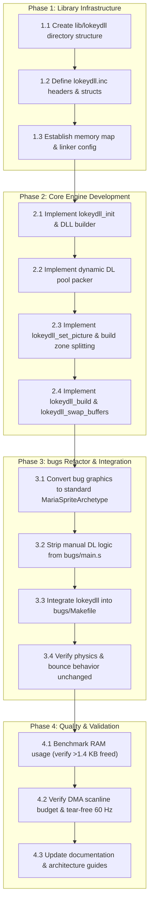

# `lokeydll`: Dynamic Display List & Multi-Zone Sprite Engine

> **Design Specification & Implementation Plan**  
> **Status:** Implemented  
> **Target Platform:** Atari 7800 ProSystem (MARIA II / 6502)  
> **Driving Reference Sample:** [`examples/bugs/`](../examples/bugs/)  
> **Related Architecture Document:** [`MariaArchitecture.md`](MariaArchitecture.md)
>
> **Author's Note / Living Document**: Everything documented here was discovered through reading vintage hardware manuals, inspecting community research, and actively building and testing working code samples on emulators and assembler toolchains with AI assistance. I might not have every nuance 100% right yet, but this is an evolving, living document that will continue to be refined and updated as I learn more through hands-on development.

---

## 1. Executive Summary & Objective

The Atari 7800 lacks hardware sprites and hardware scrolling. All on-screen elements—characters, moving enemies, HUD, backgrounds—must be scheduled into scanline **Display Lists (DL)** organized into a **Display List List (DLL)** of 8- or 16-scanline zones.

The initial [`examples/bugs`](../examples/bugs/) port successfully recreated the Atari ST "Silly Bugs" demo with 16 moving, bouncing sprites. However, its rendering pipeline currently uses **rigid, statically partitioned RAM buffers** (13 playfield zones $\times$ 66 bytes $\times$ 2 buffers = **1,716 bytes of RAM**, nearly half the console's 4 KB) and tightly couples 6502 physics with manual MARIA Display List generation.

### Core Objective

Extract the dynamic display list rendering engine from `examples/bugs` into a standalone, reusable 6502 assembly library (**`lokeydll`**). The library will provide:

1. **Dynamic Single-Pool Display List Allocation** that replaces fixed per-zone slots with one shared pool, so RAM scales with the sprites actually drawn rather than a worst-case zone layout.
2. **Automated Zone Boundary Splitting** so game code simply specifies $(X, Y)$ and an archetype pointer, with no manual slicing or zone calculation.
3. **Double-Buffered DLL Management** with tear-free VBLANK frame swapping.
4. **Zero-Overhead Static List Support** allowing static HUD/borders to reside 100% in ROM with 0 bytes of RAM overhead.

---

## 2. Architecture & Design Principles

```
┌───────────────────────────────────────────────────────────────┐
│               STAGE 1: Game Logic & Simulation                │
│  - 8.8 Fixed-point physics, collision detection, game state   │
│  - Zero knowledge of MARIA zones, DLL, or DL headers          │
│  - Writes object X,Y. Picture is attached once per slot.     │
└───────────────────────────────┬───────────────────────────────┘
                                │
                                ▼
┌───────────────────────────────────────────────────────────────┐
│                STAGE 2: `lokeydll` Render Core                │
│  - Dynamic DL Bump Allocator (writes directly to RAM pool)    │
│  - Automated Zone Slicing (Zone Z and Zone Z+1)               │
│  - Emits 4-byte Direct Headers & updates zone write offsets   │
│  - Writes $00, $00 terminators per active zone                │
└───────────────────────────────┬───────────────────────────────┘
                                │
                                ▼
┌───────────────────────────────────────────────────────────────┐
│              STAGE 3: VBLANK Hardware Flip                    │
│  - lokeydll_swap_buffers waits for MSTAT VBLANK               │
│  - Points DPPL/DPPH to newly assembled DLL / DL frame         │
│  - Switches active buffer index for next frame                │
└───────────────────────────────────────────────────────────────┘
```

### 2.1 The Dynamic Bump Allocator (RAM Savings)

Instead of partitioning RAM into 13 fixed-size playfield-zone buckets, `lokeydll` manages a single continuous dynamic pool per frame buffer:

| Allocation Model | Zone RAM Usage | Empty Zone Cost | Overhead (2 buffers) |
| --- | --- | --- | --- |
| **Static Fixed Buffers** (current `bugs`) | 66 bytes fixed / zone | 66 bytes | **1,716 bytes** |
| **`lokeydll` Dynamic Pool** | Variable (4 B / sprite) | 2 bytes (`$00, $00`) | **1,152 bytes reserved, 506 worst case** |

#### RAM Layout (`lib/lokeydll/7800.cfg`)

```
$0040 - $007F:  Game zero page
$0080 - $008F:  lokeydll zero page (13 bytes used)
$1800 - $19FF:  object table (x, y, picture fields) and zone tables — about 420 bytes for 60 sprites
$1A00 - $1BFF:  Display-list pool 0 (512 bytes)
$1C00 - $1DFF:  Display-list pool 1 (512 bytes)
$1E00 - $1E7F:  DLL 0 (64 bytes) + DLL 1 (64 bytes)
$1E80 - $1FFF:  free RAM
$2000 - $21FF:  hardware hole — NOT RAM, do not use
$2200 - $27FF:  Game state (bugs-lokey physics lives here)
```

Sixty sprites that all straddle a zone write 120 headers and at most 13 terminators: 506 bytes of a 512-byte pool, plus a 57-byte DLL. The two pools and two DLLs reserve 1,152 bytes. `bugs` reserved 1,716 bytes of fixed zone slots.

### 2.2 Zone Pointer Table Mechanism

An object is one index in parallel tables: whole-pixel X and Y, which the game writes every frame, and the picture fields `lokeydll_set_picture` copies in when the picture changes (`addr_lo`, `pal_w`, `gfx_hi + height - 16`, and the spill limit `17 - height`). The archetype is not read again while the object moves.

`lokeydll_build` then:

1. Counts headers per playfield zone from `Y` and the spill limit, including the second header when `(Y & 15) + height > 16`.
2. Packs the non-empty zones into the pool. An empty zone points at a two-byte `$00, $00` list in ROM.
3. Writes the DLL playfield entries, then writes each object's headers straight into those zones and appends a terminator. Slot 0 is written first, so it sits behind later slots.

The top piece uses `addr_hi = gfx_hi + height + fine - 16`. The bottom piece is that address minus 16. Height is 1..16, so a sprite covers at most two zones.

### 2.3 The Tooling-to-Engine Synergy: 1 Image Transformations & Scrolling Projection

The architecture connects build-time graphics generation with runtime rendering into a seamless pipeline:

1. **One Canonical Source Image $\to$ Multi-Variant ROM Bank**:
   - The artist draws only **one single canonical PNG** (e.g., ship facing North, or a single character frame).
   - `a78gfx bake` processes this single image at compile time to produce:
     - **Rotations** (`--angles 8`, `16`, `32`) with 2:1 Pixel Aspect Ratio (PAR) correction for non-square 160A pixels.
     - **Pre-baked Scaling** (`--scales 1.0, 0.75, 0.50`) for pseudo-3D depth without runtime CPU penalties.
     - **Hardware Flips** (`--flip-x`, `--flip-y`) to emulate missing hardware sprite mirroring bits.
   - All variations are stored in ROM as `MariaSpriteArchetype` tables. The game simply points `lokeydll_param_arch` to the desired angle/scale/flip variation!

2. **Decoupled Screen Mapper $\to$ Hardware-Free Scrolling**:
   - Entities move in continuous **World Space** $(X_w, Y_w)$.
   - `lokeydll` translates to **Screen Space** via $(X_s = X_w - Camera_X, Y_s = Y_w - Camera_Y)$.
   - **Viewport Culling**: Objects outside visible boundaries are dropped before touching the display list.
   - **Horizontal Ribbon Clipping**: Wide background ribbons in ROM are automatically trimmed at screen edges ($X_s < 0$ or $X_s > 160$).
   - **Vertical Fine Scrolling**: Handled by DLL Zone 0 height truncation ($(16 - F)$ scanlines) and coarse zone rollover, making scrolling completely transparent to the game logic.

3. **Multi-Frame Animation Expansion (ROM-Powered Transformation Pipeline)**:
   - `lokeydll` and `a78gfx` will support full multi-frame animation sequences (walk cycles, thrust plumes, explosions, character attacks).
   - **Universal Transformation**: Every single animation frame can pass through the exact same transformation pipeline—generating flipped, scaled, and rotated variations automatically.
   - **Trading Abundant ROM for Hardware Limitations**: MARIA lacks hardware sprite rotation, hardware scaling, hardware flipping, and hardware animation sequencers. We deliberately trade inexpensive 512 KB Flash ROM capacity ($\approx \$2$) to completely bypass these hardware limitations.
   - Instead of burning precious 6502 cycles attempting runtime software blitting, all variations are pre-compiled into ROM tables (`archetype_table[frame][angle][scale]`). Changing animation frames, angles, or sizes takes **a single 4-cycle indexed load**, giving 16-bit arcade-quality visual dynamism with **zero CPU cycle overhead and zero RAM allocation**.

---

## 3. Data Structures & Archetypes

### 3.1 Sprite Archetype (`TMariaSpriteArchetype`)

Game objects refer to pre-baked ROM archetypes generated by `a78gfx` or defined in assembly:

```ca65
.struct TMariaSpriteArchetype
    pal_w       .byte   ; Palette (bits 7..5) | (-width & $1F)
    height      .byte   ; Scanlines, 1..16
    gfx_lo      .byte   ; Graphics base, low byte
    gfx_hi      .byte   ; Graphics base, high byte
.endstruct
```

- **Width & Palette**: Packed exactly as MARIA's second header byte (`(palette << 5) | (-width & $1F)`).
- **Graphics base**: The first page of the bitmap. `a78gfx` stores scanlines bottom-up, one per 256-byte page, so page 0 is the bottom line.

### 3.2 Automated Zone Boundary Splitting

`lokeydll_build` places each object. A direct header has no height field. Maria adds the zone countdown, 15 down to 0, to the header's graphics high byte, and 16-line holey DMA turns pages outside the sprite's even 4KB block into zeroes.

Let $k = Y \bmod 16$ and $H$ be the archetype height, with $1 \le H \le 16$.

- The top zone's high byte is $\text{gfx\_hi} + H + k - 16$.
- If $k + H \le 16$, that one header covers the sprite.
- If $k + H > 16$, the next zone's high byte is the top value minus 16.

For the 16-line bugs this is the same rule as `examples/bugs`: top high byte $\text{gfx\_hi} + k$, and a second header only when $k \ne 0$.

---

## 4. `lokeydll` Public API Specification

### 4.1 Object Table And Parameter Registers

The object position is absolute so the physics loop can store it with `sta lokeydll_obj_x,y` and the builder can read it the same way. Each column is 64-byte aligned so an index of 0..59 does not cross a page.

```ca65
lokeydll_obj_x:            ; whole-pixel X, one byte per slot
lokeydll_obj_y:            ; whole-pixel Y, one byte per slot
lokeydll_obj_count:        ; leading live slots, zero page
lokeydll_param_arch_lo:    ; archetype pointer for lokeydll_set_picture
lokeydll_param_arch_hi:
lokeydll_param_ptr:        ; color list for lokeydll_load_colors
```

Picture bytes live on the same slot and are written only by `lokeydll_set_picture`.

### 4.2 Core Routines

#### `lokeydll_reset`, `lokeydll_nmi`, `lokeydll_irq` (cartridge bootstrap)

- The library owns the `VECTORS` segment and the whole boot sequence. The reset vector boots the CPU (`sei` / `cld` / `txs`), calls `lokeydll_init`, then jumps to the game's exported `lokeydll_game` entry point.
- `lokeydll_nmi` and `lokeydll_irq` are the default interrupt handlers (both `rti`). No DLL entry sets the interrupt bit, so they do not fire in the current design.
- The game never writes a MARIA register or builds a display-list structure; it only exports `lokeydll_game`.

#### `lokeydll_init`

- **Purpose**: Initializes MARIA hardware into a safe state.
- **Actions**:
  - Writes `PTCTRL = $07` (lock, MARIA enable, BIOS off).
  - Writes `CTRL = $7F` (DMA off during setup).
  - Sets `BKGRND = 0` and `CHBASE = 0`.
  - Builds both DLL buffers with blank padding zones (top/bottom) to cover 304 lines (19 zones).
  - Initializes buffer indices and points `DPPH`/`DPPL` to Buffer A.

#### `lokeydll_load_colors`

- **Input**: `lokeydll_param_ptr` points at `slot, c1, c2, c3` records from the `a78gfx` picture includes, ended by `$FF`.
- **Purpose**: Stores those colors. The game names the slot and the bytes. The library writes the registers.

#### `lokeydll_set_picture`

- **Inputs**: `Y` is the object slot and is preserved. `lokeydll_param_arch_lo/hi` point at the archetype.
- **Purpose**: Copies the picture onto that slot. Later frames do not read the archetype.
- **Actions**:
  - Stores `pal_w` and `gfx_lo`.
  - Stores `base = gfx_hi + height - 16` and `lim = 17 - height`.
  - A slot past the table sets `lokeydll_overflow` and writes nothing.

#### `lokeydll_build`

- **Purpose**: Writes the hidden pool and its DLL from slots `0 .. lokeydll_obj_count-1`. Does not wait.
- **Actions**:
  - Counts headers per zone, packs the pool, writes the playfield DLL entries, stores each header, then writes a `$00, $00` terminator on every zone that received one.
  - A count above the table is clamped and counted in `lokeydll_overflow`.

#### `lokeydll_swap_buffers`

- **Purpose**: Synchronizes with the leading edge of VBLANK and flips the active display buffer.
- **Actions**:
  - Polls `MSTAT` to exit any in-progress VBLANK, then waits for the leading edge of the next one.
  - Writes `DPPL` and `DPPH` pointing MARIA to the newly assembled DLL.
  - Toggles the build buffer (0 $\leftrightarrow$ 1) and turns 160A DMA on.

---

## 5. Implementation & Migration Plan for `examples/bugs`



### Detailed Tasks & Milestones

#### Phase 1: Library Infrastructure

- [x] **Task 1.1**: Create `lib/lokeydll/` source hierarchy (`include/`, `src/`).
- [x] **Task 1.2**: Author `lib/lokeydll/include/lokeydll.inc`. `TMariaSpriteArchetype` and the public entry points live there. `TMariaDLLEntry`, `TMariaDLHeaderDirect`, and `TMariaDLTerminator` stay in `maria.inc`.
- [x] **Task 1.3**: `lib/lokeydll/7800.cfg` is the map a game links. `examples/bugs` is unchanged.
  - `LOKEYDLL_ZP` ($0080..$008F), `LOKEYDLL_STATE` ($1800..$19FF)
  - `LOKEYDLL_RAM_A` ($1A00..$1BFF), `LOKEYDLL_RAM_B` ($1C00..$1DFF), `LOKEYDLL_DLL` ($1E00..$1E7F)
  - Game `BSS` at $2200 (1.5 KB). Pictures in `LOKEYDLL_GFX0` ($A000), `LOKEYDLL_GFX1` ($C000), `LOKEYDLL_GFX2` ($E000).

#### Phase 2: Core Engine Development (`lib/lokeydll/src/lokeydll.s`)

- [x] **Task 2.1**: Implement `lokeydll_init`. The DLL is one blank zone, 13 holey playfield zones, and five blank zones (304 lines), so PAL's 293 lines end before Maria walks off the list.
- [x] **Task 2.2**: Implement `lokeydll_set_picture` and the zone-count/assign passes of `lokeydll_build`.
- [x] **Task 2.3**: Implement `lokeydll_build` header emission with 16-line zone splitting.
- [x] **Task 2.4**: Implement `lokeydll_swap_buffers` and `lokeydll_load_colors`.

#### Phase 3: `examples/bugs-lokey`

- [x] **Task 3.1**: Beetle, circle, and square archetypes in `examples/bugs-lokey/main.s`.
- [x] **Task 3.2**: `examples/bugs-lokey/main.s` has the physics and no display-list writes. `examples/bugs` still has the hand-built lists.
- [x] **Task 3.3**: `examples/bugs-lokey/Makefile` links `lokeydll.lib`.
- [ ] **Task 3.4**: Run the ROM and confirm the bounce matches `bugs`. The physics source is the same; an emulator has not been run.

#### Phase 4: Validation & Quality Control

- [ ] **Task 4.1**: Profile RAM usage to verify the display-list buffers shrink from 1,716 bytes of fixed slots to the 1,152-byte pooled reserve (506 bytes worst-case used by 60 straddling sprites).
- [ ] **Task 4.2**: Test in `test7800` and `mame64 a7800` to confirm 60 Hz tear-free execution across zone boundaries.
- [ ] **Task 4.3**: Cross-reference and update checklist in [`MariaArchitecture.md`](MariaArchitecture.md).

---

## 6. Success Metrics & Acceptance Criteria

1. **Code Modularity**:
   - `examples/bugs-lokey/main.s` contains no MARIA registers, no display-list writes, and no reset/NMI/IRQ code; it only exports `lokeydll_game` and updates objects.
   - All Display List generation, splitting, and buffer swapping are handled exclusively by `lokeydll`.
2. **RAM Efficiency**:
   - The two pools and two DLLs reserve 1,152 bytes. A full frame of 60 straddling sprites uses 506 bytes of one 512-byte buffer. `bugs` reserved 1,716 bytes of fixed slots.
3. **Visual Fidelity & Performance**:
   - 60 bugs bounce smoothly with zero tearing or sprite clipping artifacts at zone boundaries.
   - Clean 60 Hz frame rate maintained throughout.
4. **Toolchain Integration**:
   - Clean automated build via `make -C examples/bugs-lokey` producing a signed `.a78` cartridge ROM.
   - Passes all repository lints (`cargo fmt --check`, `cargo clippy --all-targets`, `cargo test --all-targets`).

---

## 7. Guiding Design Philosophy & Immediate Next Steps

### Guiding Philosophy: "Small, Flexible, and Invisible"

The ultimate purpose of `lokeydll` and the `lokey-7800-tools` ecosystem is to free the game developer from hardware idiosyncrasies:

- **Zero Asset Friction**: Developers use `a78gfx` to turn standard PNGs into pre-baked ROM sprite archetypes with proper PAR compensation and palettes.
- **Pure World Space**: Game simulation code operates strictly on high-level Game Object positions ($X, Y$) and state.
- **Invisible Hardware Abstraction**: `lokeydll` silently manages the bump allocator, zone splitting across 16-line boundaries, display list termination, and tear-free double-buffered VBLANK flipping.

### Where the code is

`lib/lokeydll/` is the library. `examples/bugs-lokey/` is the Silly Bugs demo linked against `lokeydll.lib`. `examples/bugs/` is still the hand-built display-list version.

The ROM links and the signature checks. It has not been run in an emulator.

### Rotation & Scale (planned)

Rotation and scale stay inside the archetype: each variation is a distinct four-byte ROM archetype, and the game calls `lokeydll_set_picture` to change angle, scale, or frame. The builder reads the resolved picture bytes, so a rotated or scaled sprite needs no library change.

Two constraints to design around when adding rotation/scale:

1. **Width is free, height is not.** A wider or narrower sprite is just a different `pal_w` byte. But `height` is bounded to 1..16 lines, and the builder assumes a sprite spans at most two 16-line zones. A scaled sprite taller than 16 lines needs software height slicing (`top_h = zone_end - y`), which is future work.
2. **The 3-picture ceiling.** Each picture needs its own even 4 KB block with odd 4 KB holes, so a 32 KB cart holds three pictures today. Rotation/scale/frame variations multiply that demand and need SuperGame banking (128 KB / 512 KB).
